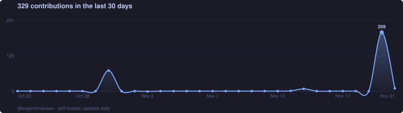

---

<!-- BANNER:START -->

  

☕ Banner 279/367

<!-- BANNER:END -->

---

<!-- STATUS:START -->

<!-- STATUS:END -->

---

---

 ## 👋 Hi, I'm Evgenii — Data & MLOps Engineer | Analytics Engineer | BI Developer

> Turning raw data into dashboards, pipelines into insights, and complexity into clarity

  &nbsp;&nbsp;
  &nbsp;&nbsp;
  

Three independent Cloudflare + Claude builds — the portfolio's own <code>ask --live</code> widget, a focused RAG practice lab grounded in 128 official USCIS civics questions + real SQL sessions, and a self-hosted mem0-style long-term memory API.

💡 I build end-to-end data pipelines and MLOps systems — from raw ingestion to production-ready dashboards — with a focus on Docker, CI/CD automation, DuckDB, and data storytelling that drives real business decisions.

---

**🛠️ Core Stack**
`SQL` • `Python` • `PostgreSQL` • `DuckDB` • `Docker` • `GitHub Actions` • `MLflow` • `Tableau` • `Power BI` • `Excel`

---

⚡ <b>How it works</b> <em>(architecture deep-dive 🔬 for engineers)</em>

This profile is a **self-updating MLOps demo** — a living portfolio showcasing production-grade automation.

### ♻️ System Architecture:
- 🤖 **Banner rotation**: 360+ GIFs · natural sorting · cache-busted CDN URLs
- 🧩 **Dynamic insights**: Context-aware NLG (time/season/DOW algorithms)
- ⏱️ **Next Update badge**: Shields.io endpoint · HLS gradient · sub-minute precision
- 📡 **Observability**: JSONL telemetry · heartbeat pings · state persistence
- ⚙️ **Zero-touch ops**: <!-- CIHEAD:START -->23,500+ cumulative workflow runs · 550+ README mutations<!-- CIHEAD:END --> · idempotent commits

### 🐍 Core Scripts:

| File | Version | Description |
|------|---------|-------------|
| <a href="https://github.com/evgeniimatveev/evgeniimatveev/blob/main/update_readme.py">update_readme.py</a> |  | Banner engine + NLG + JSONL pipeline |
| <a href="https://github.com/evgeniimatveev/evgeniimatveev/blob/main/build_next_badge.py">build_next_badge.py</a> |  | HLS gradient renderer + countdown |
| <a href="https://github.com/evgeniimatveev/evgeniimatveev/blob/main/build_activity_graph.py">build_activity_graph.py</a> |  | GitHub GraphQL → self-hosted 30-day trend chart SVG |
| <a href="https://github.com/evgeniimatveev/evgeniimatveev/blob/main/build_repo_board.py">build_repo_board.py</a> |  | GitHub GraphQL → repo-health panel (LED digits + neon border) and categorised repo index |
| <a href="https://github.com/evgeniimatveev/evgeniimatveev/blob/main/build_projects.py">build_projects.py</a> |  | Project table → collapsed categories + animated portfolio panel (numbers derived from the rows) |
| <a href="https://github.com/evgeniimatveev/evgeniimatveev/blob/main/build_ci_stats.py">build_ci_stats.py</a> |  | Actions API + workflow cron lines → this CI/CD table, self-updating |

### ⚙️ CI/CD Workflows:

<!-- CISTATS:START -->
| Workflow | Schedule | Runs¹ | Status |
|----------|----------|------|--------|
| <a href="https://github.com/evgeniimatveev/evgeniimatveev/actions/workflows/update_readme.yml">Auto Update README</a> | Daily 12:53 UTC | **5,941** |  |
| <a href="https://github.com/evgeniimatveev/evgeniimatveev/actions/workflows/next_update_badge.yml">Next Update Badge</a> | Hourly (:37) | **9,067** |  |
| <a href="https://github.com/evgeniimatveev/evgeniimatveev/actions/workflows/blank.yml">CI/CD Pipeline</a> | On push/PR | **6,541** |  |
| <a href="https://github.com/evgeniimatveev/evgeniimatveev/actions/workflows/smoke.yml">Smoke Tests</a> | Daily 08:07 UTC | **453** |  |
| <a href="https://github.com/evgeniimatveev/evgeniimatveev/actions/workflows/cache_trophies.yml">Cache GitHub Trophies</a> | Every 6h | **661** |  |
| <a href="https://github.com/evgeniimatveev/evgeniimatveev/actions/workflows/snake.yml">Generate Snake</a> | Daily 00:30 UTC | **430** |  |
| <a href="https://github.com/evgeniimatveev/evgeniimatveev/actions/workflows/badges_extra.yml">Extra Badges</a> | Daily 10:30 UTC | **185** |  |
| <a href="https://github.com/evgeniimatveev/evgeniimatveev/actions/workflows/activity_graph.yml">Activity Graph</a> | Daily 05:15 & 17:15 UTC | **160** |  |
| <a href="https://github.com/evgeniimatveev/evgeniimatveev/actions/workflows/repo_board.yml">Repo Board</a> | Daily 06:45 UTC | **9** |  |
| <a href="https://github.com/evgeniimatveev/evgeniimatveev/actions/workflows/ci_stats.yml">CI Stats</a> | Daily 03:20 UTC | **9** |  |
| <a href="https://github.com/evgeniimatveev/evgeniimatveev/actions/workflows/codeql.yml">CodeQL</a> | On push/PR · Mon 16:30 UTC | **131** |  |
<!-- CISTATS:END -->

¹ Cumulative run numbers since each workflow was created. The Actions tab only lists the runs GitHub still retains, so it shows fewer.

📊 <a href="https://github.com/evgeniimatveev/evgeniimatveev/actions">View all runs →</a>

### 📂 Observability Stack:
<pre><code>.
├─ update_log.jsonl          # CI run timeline (1 JSON per run: ts_utc, run_id, run_number, sha, banner_*, insight_*)
├─ update_log.txt            # Grep-friendly mirror of update_log.jsonl (ts UTC, run=…, sha=…; rolling tail)
├─ badges/
│  ├─ next_update.json       # Live Shields.io badge state (label, message like '~14h 35m', color bucket)
│  ├─ next_update_log.jsonl  # Badge countdown snapshots (ts, next_utc, minutes_left, message, color, jitter params)
│  ├─ next_update_log.txt    # Human-readable badge ETA tail ([ts] color=… msg='…' next_utc=… mins_left=…)
│  ├─ github_followers.json  # Endpoint payload for the Followers badge (schemaVersion/label/message/color)
│  ├─ github_stars.json      # Endpoint payload for the Stars badge
│  ├─ total_updates.json     # Endpoint payload for the Updates badge
│  ├─ trophies.svg           # Cached GitHub Trophies SVG (via Cache GitHub Trophies workflow)
│  ├─ snake_variant.json     # Active snake color variant (label/color, updated by snake.yml)
│  ├─ github_contributions.json  # Total contributions this year (GraphQL, via badges_extra.yml)
│  ├─ github_commits.json    # Commit count this year (GraphQL, via badges_extra.yml)
│  ├─ github_issues.json     # Issues opened this year (GraphQL, via badges_extra.yml)
│  ├─ activity_graph.svg     # Self-hosted 30-day trend chart (GraphQL, via activity_graph.yml)
│  ├─ repo_status.svg        # Animated repo-health panel (GraphQL, via repo_board.yml)
│  └─ projects_panel.svg     # Animated project-portfolio panel (derived from the project table, via repo_board.yml)
└─ .ci/
   ├─ heartbeat.log          # GitHub Actions heartbeat ledger (Updated on / Triggered by / Commit SHA / Run ID / Run number)
   └─ update_count.txt       # Monotonic mutation counter (powers the «N mutations shipped» tagline)
</code></pre>

**📋 Browse logs:**
📊 <a href="https://github.com/evgeniimatveev/evgeniimatveev/blob/main/update_log.jsonl">update_log.jsonl</a> ·
📝 <a href="https://github.com/evgeniimatveev/evgeniimatveev/blob/main/update_log.txt">update_log.txt</a> ·
💓 <a href="https://github.com/evgeniimatveev/evgeniimatveev/blob/main/.ci/heartbeat.log">heartbeat.log</a> ·
🔢 <a href="https://github.com/evgeniimatveev/evgeniimatveev/blob/main/.ci/update_count.txt">update_count.txt</a>
⏱️ <a href="https://github.com/evgeniimatveev/evgeniimatveev/blob/main/badges/next_update.json">next_update.json</a> ·
📡 <a href="https://github.com/evgeniimatveev/evgeniimatveev/blob/main/badges/next_update_log.jsonl">next_update_log.jsonl</a> ·
📋 <a href="https://github.com/evgeniimatveev/evgeniimatveev/blob/main/badges/next_update_log.txt">next_update_log.txt</a>
👥 <a href="https://github.com/evgeniimatveev/evgeniimatveev/blob/main/badges/github_followers.json">github_followers.json</a> ·
⭐ <a href="https://github.com/evgeniimatveev/evgeniimatveev/blob/main/badges/github_stars.json">github_stars.json</a> ·
📈 <a href="https://github.com/evgeniimatveev/evgeniimatveev/blob/main/badges/total_updates.json">total_updates.json</a> ·
🏆 <a href="https://github.com/evgeniimatveev/evgeniimatveev/blob/main/badges/trophies.svg">trophies.svg</a> ·
🐍 <a href="https://github.com/evgeniimatveev/evgeniimatveev/blob/main/badges/snake_variant.json">snake_variant.json</a> ·
📊 <a href="https://github.com/evgeniimatveev/evgeniimatveev/blob/main/badges/github_contributions.json">github_contributions.json</a> ·
🔨 <a href="https://github.com/evgeniimatveev/evgeniimatveev/blob/main/badges/github_commits.json">github_commits.json</a> ·
🐛 <a href="https://github.com/evgeniimatveev/evgeniimatveev/blob/main/badges/github_issues.json">github_issues.json</a> ·
📅 <a href="https://github.com/evgeniimatveev/evgeniimatveev/blob/main/badges/activity_graph.svg">activity_graph.svg</a>

---

## 🚀 Engineering Background

- 📊 Dashboards that answer real business questions — Data Analytics & BI (Tableau, Power BI)
- 🧠 Advanced SQL — CTEs, window functions, optimization (not just `SELECT *`) · data modeling: star schema, dimensional modeling, data contracts
- ⚙️ Analytics Engineering — ETL/ELT pipelines end-to-end (Python, PostgreSQL, DuckDB), fast, reproducible, production-grade
- ☁️ Cloud Analytics — Azure Databricks, Data Factory, Synapse Analytics
- 🐍 Python & R for data science workflows
- 🤖 Agentic AI Engineering — Claude Code workflows for architecture, debugging & production incident response; fixes verified against real logs and screenshots, not guesses

> 🧭 3+ years delivering production data pipelines, live analytics dashboards,
> and automated MLOps workflows — from raw ingestion to deployed applications

---

### Continuous Learning
- 🎓 Currently: Udemy — Data Engineering · [30+ certifications on LinkedIn](https://www.linkedin.com/in/evgenii-matveev-510926276/details/certifications/)

---

<!-- BADGES:START -->

<!-- BADGES:END -->

<!-- EXTRA_BADGES:START -->

  
  
  

<!-- EXTRA_BADGES:END -->

---

<!-- PROJECTS:START -->

<b>🧠 AI & Cloudflare systems</b> <em>(5)</em>

| Project | Highlights | Demo |
|---------|-----------|------|
| 🧠 [Agent Memory](https://github.com/evgeniimatveev/agent-memory) | Cloudflare Vectorize + Workers AI + D1 + Claude Haiku 4.5 · mem0/Supermemory-style memory API · atomic fact extraction · similarity × importance × recency re-ranking | [🌐 Live](https://evgeniimatveev.github.io/agent-memory/) |
| 🦎 [Civics × SQL RAG Lab](https://github.com/evgeniimatveev/civics-sql-rag) | Cloudflare Vectorize + Workers AI (bge-m3) + Claude Haiku 4.5 · 128 official USCIS civics Q&A + real SQL practice sessions · single index, metadata-filtered by mode | [🌐 Live](https://evgeniimatveev.github.io/civics-sql-rag/) |
| 🔌 [MCP Data Quality Agent](https://github.com/evgeniimatveev/mcp-data-quality-agent) | 19 MCP tools · 5 databases · Claude AI · natural language analytics | — |
| 🎓 [Data Interview Coach](https://github.com/evgeniimatveev/interview-coach) | 35 questions · SQL + Behavioral + Project + Stats · Claude API · streaming feedback · SQLite |  |
| 🦙 [FastAPI + Ollama Playground](https://github.com/evgeniimatveev/mlops_ollama_env) | Local LLM inference · phi3 · llama3 · deepseek-r1 · streaming API · Docker Compose | — |

<b>📊 Live data apps & dashboards</b> <em>(8)</em>

| Project | Highlights | Demo |
|---------|-----------|------|
| 🚚 [Route Optimization VRP](https://github.com/evgeniimatveev/route-optimization-vrp) | CVRPTW · Google OR-Tools · 100% vs 11% on-time · 18.7% distance saved · $82/day saved |  |
| ₿ [Crypto On-Chain Dashboard](https://github.com/evgeniimatveev/crypto-dashboard) | Top 20 coins · Fear & Greed · BTC dominance · DuckDB · daily pipeline |  |
| 📉 [Tech Layoffs Tracker](https://github.com/evgeniimatveev/layoffs-tracker) | 2,412 events · 747K people · 49 countries · DuckDB · weekly refresh |  |
| 📊 [SO Survey Analytics](https://github.com/evgeniimatveev/so-survey-analytics) | 65K devs · 20 SQL queries · Remote +51% · DuckDB · 23 CI tests |  |
| 🌍 [Global Weather Pipeline](https://github.com/evgeniimatveev/weather-pipeline) | 20 cities · 6 continents · Best City Score · 7d Forecast · Quality Layer |  |
| 📈 [Job Market Pulse](https://github.com/evgeniimatveev/job-market-pulse) | 10 stacks · 10 US cities + remote · 110 API calls/day · DuckDB · daily pipeline | [🤗 Live](https://huggingface.co/spaces/evgeniimatveevusa/job-market-pulse) |
| 🛒 [Olist Analytics](https://github.com/evgeniimatveev/olist-e-commerce-analytics) | dbt · 54 tests · $13.2M · 96K orders | [🤗 Live](https://huggingface.co/spaces/evgeniimatveevusa/olist-analytics) |
| 🚗 [Uber Driver Analytics](https://github.com/evgeniimatveev/uber-driver-analytics) | 3,448 trips · $70K gross · 98.9% rating |  |

<b>📈 Analytics, BI & SQL</b> <em>(6)</em>

| Project | Highlights | Demo |
|---------|-----------|------|
| 📐 [Tableau LOD Cases](https://github.com/evgeniimatveev/tableau-business-cases) | 5 Tableau LOD case studies · 91 numbers reconciled in DuckDB · 8 gotchas documented · pytest + GitHub Actions CI | [📊 Live](https://public.tableau.com/app/profile/evgenii.matveev/viz/LOD_cohoranalysishmdashboard/Dashboard1) |
| ❄️ [Snowflake A-Z](https://github.com/evgeniimatveev/Snowflake-A-Z) | 11 hands-on practices · Snowpark · Dynamic Tables · RBAC · native Streamlit · SQLFluff CI | — |
| 🏢 [HR BI Analytics](https://github.com/evgeniimatveev/hr-bi-analytics-project) | 30 employees · 5 depts · Sales $102K avg · Tableau | — |
| 🛍️ [Business SQL Analytics](https://github.com/evgeniimatveev/business-sql-analytics) | 2,314 cust · 5K transactions · $2.58M · 59.8% returning | — |
| 🦆 [NYC 311 DuckDB](https://github.com/evgeniimatveev/nyc-311-duckdb-motherduck-analysis) | 22,504 records · Bronx 41.5% · DuckDB · MotherDuck | — |
| 💼 [Remote Job Tracker](https://github.com/evgeniimatveev/remote-job-tracker) | 100 listings · 5% remote · Munich 36% · API→Tableau | — |

<b>🐳 MLOps & pipelines</b> <em>(4)</em>

| Project | Highlights | Demo |
|---------|-----------|------|
| 🔍 [Neon Data Diff](https://github.com/evgeniimatveev/neon-data-diff) | GitHub Action · dbt base vs PR code on a copy-on-write Neon branch · SQL data diff · sticky PR comment · 25 tests · Postgres 16/17 CI | [🌐 Live](https://evgeniimatveev.github.io/neon-data-diff/) |
| 📦 [CV Logistics MLOps](https://github.com/evgeniimatveev/cv-logistics-mlops) | ResNet18 transfer learning · MLflow + W&B · val_mae 0.755 · weekly automated retraining | — |
| 🔄 [ETL Pipeline](https://github.com/evgeniimatveev/data-pipeline-etl-project) | Faker → PostgreSQL · SQLFluff CI · Docker | — |
| 🤖 [MLOps Project](https://github.com/evgeniimatveev/mlops_project) | R²=0.8326 · RMSE $46K · MLflow + W&B · 729 GridSearch | — |

+ 16 more repos (A&ndash;Z learning, forks, portfolio site) are in the <b>Repository Index</b> below &middot; every repo appears once

<!-- order: neon-data-diff,tableau-business-cases,agent-memory,civics-sql-rag,route-optimization-vrp,cv-logistics-mlops,crypto-dashboard,layoffs-tracker,so-survey-analytics,weather-pipeline,mcp-data-quality-agent,interview-coach,job-market-pulse,olist-e-commerce-analytics,uber-driver-analytics,Snowflake-A-Z,hr-bi-analytics-project,business-sql-analytics,nyc-311-duckdb-motherduck-analysis,data-pipeline-etl-project,remote-job-tracker,mlops_project,mlops_ollama_env -->
<!-- PROJECTS:END -->

---

## ⚙️ Analytics Stack (Production-Level)

**🛢️ Languages & Databases**  
     

**📊 Data & Analytics**  
   

**📈 BI & Visualization**  
  

**☁️ Cloud & Data Engineering**  
    

**🚀 Deployment & Serving**  
   

**⚙️ Automation & Workflow**  

**🐳 Reproducibility & MLOps**  
  

**🧪 Data Tools**  

---

  <!-- BEGIN: COPILOTS -->
  

    
⚡ AI-Powered Engineering Workflow

  | Assistant | Role | Usage |
  |-----------|------|--------|
   | 🧠 Claude Sonnet 5 | **Primary AI Partner** — architecture · code · analytics · docs · review | Primary |
   | 🖥️ Claude Code (CLI) | **Agentic Runtime** — full-auto sessions · persistent context · tool-verified changes | Primary |
   | 🕵️ OpenAI Codex CLI | **Second Opinion** — blind code review · isolated one-off tasks · breaking stuck-debug loops | On-demand |

   

      
💡 <b>How Claude fits into my workflow</b>

  Claude Sonnet 5 is my primary AI engineering partner across all stages of the data & MLOps lifecycle:

  - 🏗️ **Architecture** → pipeline design, schema decisions, project structure
  - 🐍 **Code** → Python scripts, SQL queries, Docker configs, GitHub Actions workflows
  - 📊 **Analytics** → data modeling, query optimization, business logic translation
  - 📝 **Documentation** → READMEs, project descriptions, technical write-ups
  - 🔍 **Review** → debugging, code quality, edge case analysis
  - 🚨 **Production Ops** → live incident triage from real logs/screenshots — root-cause diagnosis, verified fix, deployed and re-checked in-session

  > Precision-first · Context-engineered · Production-grade output.

   

   

      
🕵️ <b>How Codex CLI fits into my workflow</b>

  OpenAI Codex CLI is my second opinion — deliberately kept blind to Claude's project context, so it reviews cold instead of just echoing conclusions I've already reached:

  - 🔍 **Blind code review** → reviews a diff/module with zero access to my CLAUDE.md conventions or fix history — catches what a context-loaded reviewer misses
  - 🌐 **Isolated translation** → one-off conversions (e.g. SQL dialect ports) where the output is easy to verify standalone
  - 🧯 **Breaking stuck-debug loops** → brought in fresh, with no memory of failed attempts, when the primary agent is stuck re-fixing the same bug
  - 🌳 **Isolated via `git worktree`** → runs on its own branch in its own directory, never alongside the primary agent in the same working tree, so neither can silently overwrite the other's edits

  > First real find (2026-09-20): a blind Codex review of `route-optimization-vrp`'s OR-Tools segfault-isolation code surfaced two real bugs — a timeout that didn't actually kill a hung worker, and no cap on concurrent solves — that 5 prior fix commits had missed. Verified against the actual code, fixed, and shipped in [PR #1](https://github.com/evgeniimatveev/route-optimization-vrp/pull/1), confirmed clean in production logs post-deploy.

   

  

  <!-- END: COPILOTS -->

---
  <!-- BEGIN: AI_SYSTEMS_IN_PRODUCTION -->
  

    
🛰️ AI Systems in Production

  

    
🤖 <b>RAG Ask-Widget — Live on This Profile</b>

  An interactive Q&A widget embedded on this page, answering visitor questions about my projects and background in real time — a shipped AI product I designed and deployed end-to-end, not just a tool I use for work.

  | Component | Implementation |
  |-----------|------|
  | 🔎 **Retrieval** | Cloudflare Vectorize — 1024-dim index, cosine similarity, multilingual `bge-m3` embeddings |
  | 🧠 **Generation** | Claude (Anthropic API) — grounded, context-injected answers |
  | 📥 **Ingestion** | Cloudflare Queues — async corpus embedding/upsert, dead-letter queue for failed jobs |
  | 🛡️ **Bot protection** | Cloudflare Turnstile — verified before any rate-limit or generation cost is incurred |
  | ⏱️ **Rate limiting** | Per-IP + global daily caps via Workers KV — cost-bounded by design |
  | 📊 **Analytics** | Cloudflare D1 — anonymized topic/language classification per question |
  | ⚡ **Runtime** | Fully serverless, edge-deployed on Cloudflare Workers — zero always-on infrastructure |

  🌐 [Live demo →](https://evgeniimatveev.github.io/) · 💻 [Source →](https://github.com/evgeniimatveev/evgeniimatveev.github.io/tree/main/worker)

  🔒 Privacy by design: analytics store only a keyword-classified topic bucket and detected language — never the raw question text.

  

  

    
🧠 <b>agent-memory — Self-Hosted Memory Layer for AI Agents</b>

  A mem0/Supermemory-style long-term memory API — extracts atomic facts from raw text, embeds and stores them, then retrieves by relevance, importance and recency, not similarity alone. A standalone shipped AI product (separate repo), built on the same Cloudflare pattern as the ask-widget above, not a wrapper around a third-party memory service.

  | Component | Implementation |
  |-----------|------|
  | 🧠 **Extraction** | Claude Haiku 4.5 — pulls typed, atomic facts (preference/fact/event/correction) with an importance score out of raw text |
  | 🔎 **Retrieval** | Cloudflare Vectorize — 1024-dim index, cosine similarity, `bge-m3` embeddings |
  | 🗂️ **Storage** | Cloudflare D1 — structured metadata (type, importance, timestamps) |
  | ⚖️ **Re-ranking** | `similarity × importance-weight × recency-decay` — an important fact from weeks ago still outranks a trivial fresh one |
  | ⚡ **Runtime** | Fully serverless, edge-deployed on Cloudflare Workers |

  🌐 [Live demo →](https://evgeniimatveev.github.io/agent-memory/) · 💻 [Source →](https://github.com/evgeniimatveev/agent-memory)

  

   

      
🎨 <b>Creative & Content Generation</b>

  Portfolio banner visuals for all project cards were generated with **Gemini (nano banana)**, refined through iterative prompting — concept → test batch → visual QA (composition, palette, icon accuracy) → full rollout. Design/marketing tooling only — engineering work stays on the Claude stack above.

   

      
🖼️ <b>See the generation process (3 examples)</b>

   

  
  
<em>MLOps Docker — real Docker whale icon instead of a generic shield, two-panel layout</em>

  
  
<em>Snowflake — single-panel + floating badge layout, brand-accurate snowflake mark</em>

  
  
<em>Route Optimization — three-panel cascading layout, first fully-validated complex composition</em>

   

   

  

  <!-- END: AI_SYSTEMS_IN_PRODUCTION -->

---
<!-- BEGIN: AUTOMATION -->

  
🤖 Automation Logs

  <!-- RUNMETA:START -->

  
🪄 Run Meta (click to expand)

- 📆 Updated (UTC): **2026-11-25 22:09 UTC**
- 🤖 Run: **#5942** — [open run](https://github.com/evgeniimatveev/evgeniimatveev/actions/runs/45709350808)
- 🧬 Commit: **718522a** — [open commit](https://github.com/evgeniimatveev/evgeniimatveev/commit/718522ab6293a5de61b6478543b49f6fdc8d0513)
- ♻️ Updates (total): **553**
- 🌀 Workflow: **Auto Update README** · Job: **update-readme**
- ✨ Event: **schedule** · 🧑‍💻 Actor: **evgeniimatveev**
- 🕒 Schedule: **24h_5m**
- 🌈 Banner: **279/367**

<!-- RUNMETA:END -->

  <!-- LOG:START -->

🗂️<b>Recent updates (last 5)</b>

| Time (UTC) | Run | SHA | Banner | Event/Actor | Insight|
|---|---|---|---|---|---|
| 2026-11-25 22:09:37 | 5942 | `718522a` | 279/367 (279.gif) | schedule/evgeniimatveev | 📡 SQL • PYTHON • PIPELINES • RUN #5942 — Budget For Winter Retrains Now 🧮 &#124; Halfway There — Keep Automating! 🛠️ Relax And Let Automa… |
| 2026-11-24 22:51:09 | 5941 | `6fbe0ee` | 278/367 (278.gif) | schedule/evgeniimatveev | 📡 DATA • PLATFORMS • VALUE • RUN #5941 — Harvest your best MLOps ideas 🌾 &#124; Keep up the momentum! 🔥 Relax and let automation handle y… |
| 2026-11-24 00:32:48 | 5940 | `2411a06` | 277/367 (277.gif) | schedule/evgeniimatveev | 📡 OBSERVE • ALERT • IMPROVE • RUN #5940 — Prune legacy, keep essentials ✂️ &#124; Keep up the momentum! 🔥 Write the changelog you wish yo… |
| 2026-11-22 20:06:36 | 5939 | `cf73a3d` | 276/367 (276.gif) | schedule/evgeniimatveev | 📡 LOW TOIL, HIGH LEVERAGE • RUN #5939 — BACKFILL HISTORY, RECONCILE TRUTH SOURCES 🧾 &#124; PREP FOR AN MLOPS-FILLED WEEK! ⏳ RELAX AND LET… |
| 2026-11-21 23:14:40 | 5938 | `84ee181` | 275/367 (275.gif) | workflow_dispatch/evgeniimatveev | 📡 DATA • PLATFORMS • VALUE • RUN #5938 — Reflect, refine, retrain 🍂 &#124; Weekend automation vibes! 🎉 Write the changelog you wish you h… |

<!-- LOG:END -->

<!-- END: AUTOMATION -->

---

### 🐍 Auto-Rotating GitHub Snake

  

  

  <em>Night-mode palettes · Daily A–N theme rotation · 14 colors · Fully automated via GitHub Actions</em>

---

 | 📊 Data Analyst              | 🔧 Data Engineer                        | 🤖 MLOps Engineer                    |
  |-----------------------------|----------------------------------------|--------------------------------------|
  | SQL · Tableau · Power BI    | PostgreSQL · DuckDB · dbt · Docker     | MLflow · W&B · XGBoost · FastAPI     |
  | Dashboards → KPIs → Decisions | Raw Data → Pipelines → Production    | Train → Track → Deploy → Monitor     |

---

<!-- CIBADGES:START -->

  
  
  

  
  
  

  
  
  

<!-- CIBADGES:END -->

---

<!-- INSIGHT:START -->
🤖 MLOPS Insight: 📡 SQL • PYTHON • PIPELINES • RUN #5942 — Budget For Winter Retrains Now 🧮 | Halfway There — Keep Automating! 🛠️ Relax And Let Automation Handle Your Work 🤖 🌙
<!-- INSIGHT:END -->

---

 

  
<b>📈 Auto GitHub Insights</b> <em>(UTC · auto-refresh)</em>

  

    
  

  

    
  

  

    
  

  

    
    
  

  

    
  

  

    
  

  

    Daily contributions · last 30 days · self-hosted (GitHub GraphQL → SVG, refreshed daily — no third-party renderer)
  

  

---

## 🗂️ Repository Index

<!-- REPOS:START -->

<b>37 own repos</b> = <b>23</b> featured projects in <b>Project Portfolio</b> above + <b>14</b> listed here (+ 2 forks) &middot; every repo appears once

<b>🌐 Portfolio site & other live systems</b> <em>(1)</em>

| Repo | What it is | Lang | CI | Updated | ⭐ |
|---|---|---|:-:|---|--:|
| [**evgeniimatveev.github.io**](https://github.com/evgeniimatveev/evgeniimatveev.github.io) | Terminal-emulator portfolio site — live uptime across 9 apps, real incident postmortems,… | 🟧 HTML | 🟢 | today | 1 |

<b>🎓 A–Z learning repos</b> <em>(13)</em>

| Repo | What it is | Lang | CI | Updated | ⭐ |
|---|---|---|:-:|---|--:|
| [**EXCEL-A-Z**](https://github.com/evgeniimatveev/EXCEL-A-Z) | Excel analytics: pivot tables, pivot charts, 8 real-world case studies (social media, spo… | — | 🟢 | 4d ago | 7 |
| [**Power-BI-A-Z**](https://github.com/evgeniimatveev/Power-BI-A-Z) | Power BI from scratch: bar charts, time series, geographic maps, scatterplots, full dashb… | 📄 CSV | 🟢 | 4d ago | 7 |
| [**Python-Projects**](https://github.com/evgeniimatveev/Python-Projects) | Python project collection across branches: ML forecasting, NLP sentiment, CV (YOLOv5/Medi… | 🐍 Python | 🟢 | 4d ago | 7 |
| [**SQL-Database-Design-A-Z**](https://github.com/evgeniimatveev/SQL-Database-Design-A-Z) | SQL database design in PostgreSQL: normalization (1NF→3NF), ERD diagrams, subqueries, win… | 🛢️ SQL | 🟢 | 4d ago | 7 |
| [**Advanced-SQL-Data-Management-A-Z**](https://github.com/evgeniimatveev/Advanced-SQL-Data-Management-A-Z) | Advanced SQL in MySQL 8.0: window functions, pivot tables, regex, stored procedures, empl… | 🛢️ SQL | 🟢 | 4d ago | 7 |
| [**ML-Classics-in-Python**](https://github.com/evgeniimatveev/ML-Classics-in-Python) | ML fundamentals in Python: data preprocessing, regression, classification, clustering, Ap… | 🐍 Python | 🟢 | 4d ago | 7 |
| [**Ml-Classics-Level2-Boosting**](https://github.com/evgeniimatveev/Ml-Classics-Level2-Boosting) | Advanced ML with gradient boosting: XGBoost, LightGBM, CatBoost — regression, classificat… | 🐍 Python | 🟢 | 4d ago | 7 |
| [**ML-Classics-in-R**](https://github.com/evgeniimatveev/ML-Classics-in-R) | ML fundamentals in R: data preprocessing, regression, classification, clustering, associa… | 📈 R | 🟢 | 4d ago | 7 |
| [**Advanced-R-for-Analytics**](https://github.com/evgeniimatveev/Advanced-R-for-Analytics) | Advanced R analytics: data cleaning, NA imputation, apply/lapply/sapply, time-series visu… | 📈 R | 🟢 | 4d ago | 7 |
| [**Python-for-Data-Science-A-Z**](https://github.com/evgeniimatveev/Python-for-Data-Science-A-Z) | Python for data science: NumPy matrices, Pandas DataFrames, data visualization, real-worl… | 🐍 Python | 🟢 | 4d ago | 7 |
| [**Feature-Engineering**](https://github.com/evgeniimatveev/Feature-Engineering) | End-to-end feature engineering: data cleaning, transformations (log/power/scaling/encodin… | 📓 Jupyter Notebook | 🟢 | 4d ago | 7 |
| [**Python-Programming-A-Z**](https://github.com/evgeniimatveev/Python-Programming-A-Z) | Python fundamentals A-Z: variables, control flow, functions, file handling, NumPy, Pandas… | 🐍 Python | 🟢 | 4d ago | 7 |
| [**R-Programming-A-Z**](https://github.com/evgeniimatveev/R-Programming-A-Z) | R programming A-Z: variables, vectors, matrices, data frames, ggplot2 layers and themes.… | 📈 R | 🟢 | 4d ago | 7 |

<b>🧩 Self-hosted widgets & forks</b> <em>(2)</em>

| Repo | What it is | Lang | CI | Updated | ⭐ |
|---|---|---|:-:|---|--:|
| [**snk**](https://github.com/evgeniimatveev/snk) fork | 🟩⬜ Generates a snake game from a github user contributions graph and output a screen capt… | 🔷 TypeScript | ⚪ | 3w ago | 7 |
| [**github-profile-trophy**](https://github.com/evgeniimatveev/github-profile-trophy) fork | 🏆 Add dynamically generated GitHub Stat Trophies  on your readme | 🔷 TypeScript | ⚪ | 2mo ago | 6 |

Generated from the GitHub GraphQL API by <code>build_repo_board.py</code> · CI = default-branch check status · refreshed daily · no third-party renderer

<!-- REPOS:END -->

---

  &nbsp;&nbsp;
  &nbsp;&nbsp;
  

---
